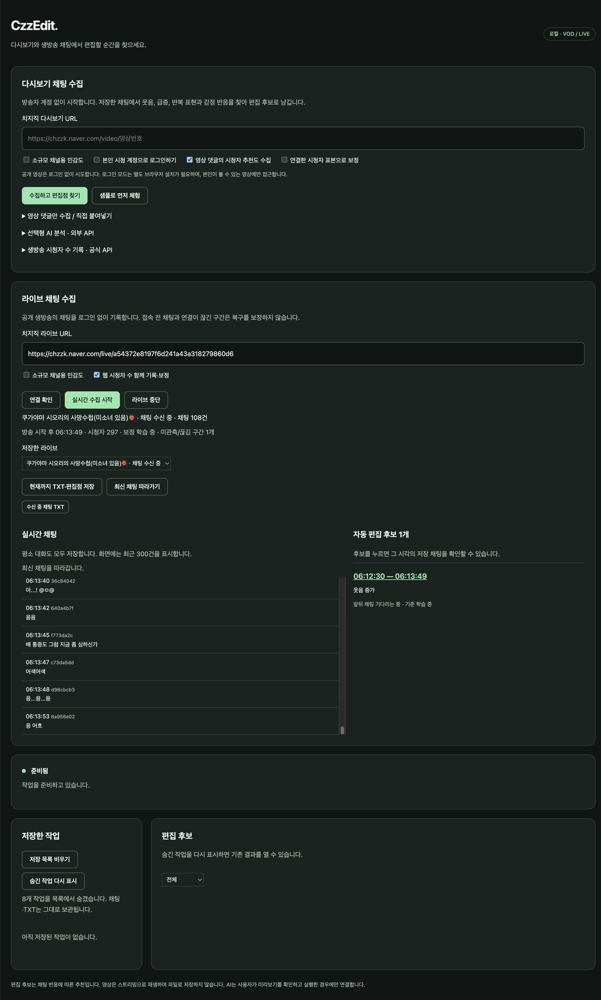
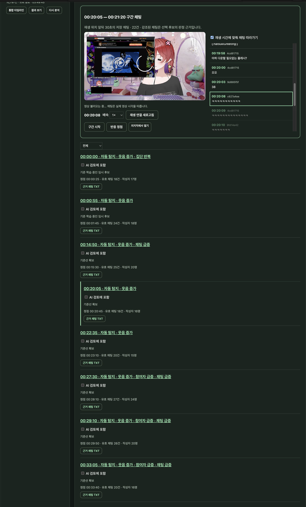
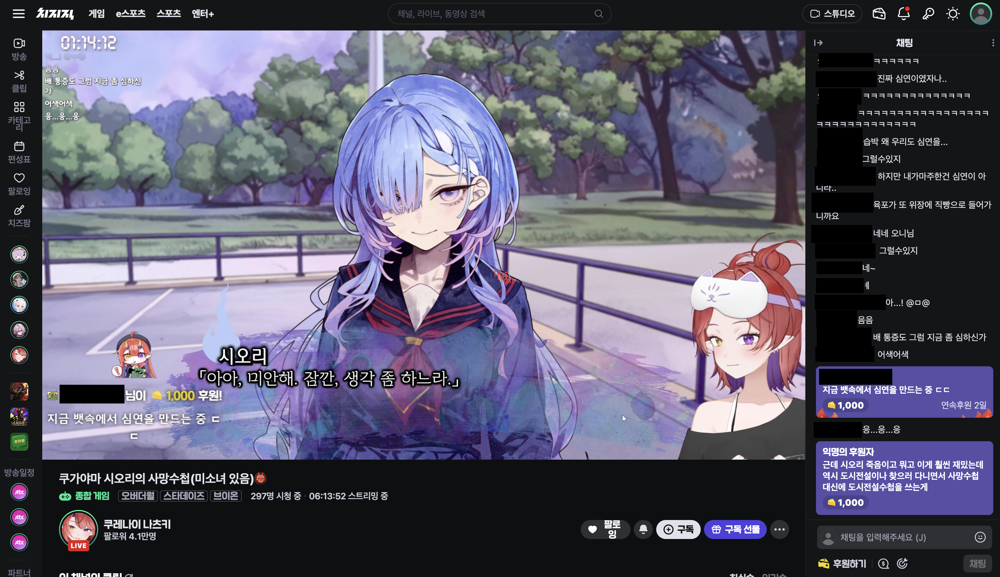

# CzzEdit

치지직 방송자와 편집자가 **편집할 순간을 함께 찾는 로컬 앱**입니다. 다시보기와 공개 생방송에서 받은 채팅을 저장하고, 웃음·반복·채팅 급증을 시간순 편집 후보로 정리합니다.

**공개 방송은 방송자 계정·개발자 키 없이 시작할 수 있습니다.** Python이 없어도 설치 스크립트가 실행 환경을 준비합니다.

**현재 공개 준비 버전: 0.3.2** · Python 3.10 이상 · Windows / macOS / Linux용 설치·실행 스크립트

치지직 공식 서비스나 제휴 앱은 아닙니다. 수집에는 치지직 웹의 비공식 조회·읽기 연결을 사용하며, 서비스 변경이나 시청 제한에 따라 이용이 어려울 수 있습니다.

[설치와 실행](#설치와-실행) · [다시보기 사용법](#다시보기-사용법) · [생방송 사용법](#생방송-사용법) · [개인정보와 외부 전송](#개인정보와-외부-전송) · [문제 해결](#검증-범위와-문제-해결)

<!-- screenshots:start -->

## 화면 미리보기

| 생방송 채팅 수집 · 자동 편집 후보 | 다시보기 영상 · 채팅 함께 보기 |
|---|---|
| <a href="Image/Live_edit.png"></a> | <a href="Image/Re_edit.png"></a> |
| 받은 채팅을 저장하면서 반응 구간을 편집 후보로 기록합니다. | 후보를 누르면 해당 시각으로 이동하고 재생 시간에 맞춰 채팅이 따라갑니다. |

이미지를 누르면 전체 크기로 볼 수 있습니다.

<details>
<summary>치지직 원본 생방송 화면과 비교</summary>



`Live_real.png`는 치지직 사이트의 시청 화면입니다. 생방송 영상은 치지직에서 보고, CzzEdit에서는 채팅을 수집하고 편집 후보를 확인합니다. 앱 내부 영상 재생은 다시보기에서 지원합니다.

</details>

스크린샷은 사용자가 제공한 사용 예시입니다. 후원·구독 알림과 채팅창의 시청자 닉네임은 공개용 이미지에서 가렸습니다. 이 가림 처리는 앱의 자동 처리 기능이 아닙니다.
<!-- screenshots:end -->

## 주요 기능

| 기능 | 동작 |
|---|---|
| 다시보기 수집 | 채팅을 페이지별로 받아 로컬 DB·TXT에 저장하고 중단한 위치에서 이어받기 |
| 실시간 수집 | 다시보기 입력 아래 LIVE URL 입력 → 새 채팅 수신 → 저장·편집 후보 갱신 |
| 일반 대화 보관 | 편집 후보 여부와 관계없이 수신한 채팅 보관. LIVE 화면은 최근 300건 표시 |
| 자동 편집 후보 | 웃음, 채팅량, 반복 문구, 감정 반응, 참여자 증가를 시간순으로 정리 |
| 시청자 추천 | VOD 영상 아래 댓글의 타임스탬프를 읽어 자동 후보와 별도 출처로 표시 |
| VOD 검토 | 후보 클릭 → 앱 내부 영상의 해당 시간으로 이동 → 재생 시각에 맞춰 채팅 표시 |
| LIVE 검토 | 후보 클릭 → 그 시각 앞뒤 30초의 저장 채팅을 최대 300건 표시 |
| 연결 복구 | LIVE 자동 재연결, 끊긴 구간 표시, 중단·같은 방송 이어 기록 |
| 내보내기 | 전체 채팅 TXT/JSONL, 편집 후보 TXT/CSV/JSON, 후보별 주변 채팅 |
| 시청자 기준 보정 | LIVE의 공개 웹 시청자 수를 함께 기록하고 감소 시 채팅 기준 재학습 |
| 저장 목록 정리 | 기존 작업을 목록에서만 숨기고 다시 표시. 원본 채팅·TXT 보관 |
| 선택형 AI | 사용자가 미리보기를 확인한 뒤 실행하는 외부 API 검토. 자동 실행 없음 |

자동 탐지는 웃음 증가, 평소 대비 채팅 급증, 같은 말의 집단 반복, 감정 반응, 참여자 증가를 기준으로 합니다. 학습 자료가 부족한 초반은 임시 후보로 표시하며, **소규모 채널용 민감도**를 켜면 작은 반응도 찾지만 오탐이 늘 수 있습니다.

후보는 채팅 반응에 따른 추천이므로 실제 영상 장면을 확인해 편집 구간을 결정하세요. LIVE 영상 재생·LIVE 후보와 VOD 시간 연결·방송 및 도네이션 음성 분석·채팅 전송은 현재 제공하지 않습니다.

## 설치와 실행

1. 저장소의 **Code → Download ZIP**으로 내려받아 압축을 풉니다.
2. 아래 표에서 사용하는 OS의 **설치** 파일을 실행합니다.
3. 설치가 끝나면 **실행** 파일을 열고 브라우저에서 시작합니다.

| 환경 | 최초 설치·업데이트 | 실행 |
|---|---|---|
| Windows | `install.cmd` | `run.cmd` |
| macOS (더블클릭) | `설치.command` | `실행.command` |
| Linux (터미널) | `sh install.sh` | `sh run.sh` |

**macOS에서는 `설치.command`를 먼저 더블클릭하고, 설치가 끝나면 `실행.command`를 더블클릭하세요.** `.sh`는 터미널용 파일이므로 더블클릭하면 Xcode 같은 연결된 편집기가 열릴 수 있습니다. `.command`는 터미널에서 실행되고 오류가 발생하면 확인할 수 있도록 창을 유지합니다. macOS에서도 터미널의 `sh install.sh` / `sh run.sh` 사용은 가능합니다.

설치 스크립트는 Python 3.10 이상이 있으면 재사용하고, 없으면 해당 OS·CPU에 맞는 Python 3.13을 프로젝트 안에 준비합니다. **앱은 항상 프로젝트의 `.venv` 가상환경에서 실행**합니다. 시스템 Python·영구 PATH는 변경하지 않습니다. 최초 설치에는 인터넷이 필요하며 프로젝트 안의 uv 도구로 의존성을 설치합니다. macOS/Linux에는 curl 또는 wget이 필요합니다.

설치 후 실행하면 [로컬 앱](http://127.0.0.1:8765/)이 열립니다. 처음에는 **샘플로 먼저 체험**으로 결과 화면을 확인할 수 있습니다.

종료할 때는 진행 중인 작업을 마치고, LIVE는 **라이브 중단**을 눌러 저장이 끝난 뒤 실행한 터미널에서 **Ctrl+C**를 누르세요. 브라우저 탭만 닫으면 서버와 수집은 계속됩니다. 다른 프로그램이 같은 포트를 쓰면 `sh run.sh serve --port 8766` 또는 `run.cmd serve --port 8766`으로 바꿀 수 있습니다.

macOS에서 설치·실행을 검증했습니다. Windows/Linux용 스크립트는 포함하지만 해당 OS의 실제 실행 검증은 남아 있습니다. 업데이트 시 기존 `.czzedit` 데이터를 보존하고 설치 스크립트를 다시 실행하세요. 실행 중인 앱을 종료한 뒤 코드를 교체하고 새로 실행해야 변경이 반영됩니다.

## 다시보기 사용법

1. `/video/영상번호` 형태의 치지직 다시보기 URL을 입력합니다.
2. **수집하고 편집점 찾기**를 누릅니다. 계정 없이 **샘플로 먼저 체험**할 수도 있습니다.
3. 시간순으로 정리된 후보를 누르면 앱 내부 영상이 해당 시각으로 이동합니다. **재생 시간에 맞춰 채팅 따라가기**를 켜면 영상과 채팅을 함께 확인할 수 있습니다.
4. 전체 채팅 또는 후보·근거 파일을 내려받습니다. 실패한 작업은 저장 목록에서 이어받거나 저장 자료를 다시 분석합니다.

**영상 댓글의 시청자 추천도 수집**은 VOD 아래 댓글에 적힌 시각을 별도로 추출합니다. 방송 당시의 실시간 채팅과 섞어 저장하지 않고 타임라인에서 출처를 구분합니다. 댓글을 직접 붙여넣는 방법도 지원합니다.

일반 시청 계정 로그인이 필요한 VOD는 `install.cmd --login` 또는 `sh install.sh --login`으로 선택 의존성을 설치한 후, 화면의 **본인 시청 계정으로 로그인하기**를 사용합니다. 본인이 볼 수 있는 범위에만 접근하며 실제 로그인 계정 검증은 남아 있습니다. 이 옵션은 LIVE에 적용되지 않습니다.

## 생방송 사용법

1. 다시보기 입력 아래 **치지직 라이브 URL**에 `/live/채널ID` 형태의 주소를 입력합니다.
2. **연결 확인**으로 방송 상태를 확인하고 **실시간 수집 시작**을 누릅니다.
3. 수신한 평소 대화도 모두 저장하고, 반응이 눈에 띄는 구간을 편집 후보로 표시합니다. 넓은 화면에서는 채팅과 후보가 나란히 보입니다. 위로 스크롤해도 수집·저장은 계속되며 **최신 채팅 따라가기**로 돌아올 수 있습니다.
4. **현재까지 TXT·편집점 저장**으로 그 시점의 고정된 출력 묶음을 만들 수 있습니다.
5. **라이브 중단**은 남은 입력을 저장하고 마감합니다. 같은 방송 회차가 진행 중이면 **같은 방송 이어 기록**으로 재개합니다.

접속 전 채팅이나 연결이 끊긴 동안의 채팅은 소급 복구를 보장하지 않습니다. 연결 공백은 기록하며 채팅이 없었던 시간으로 학습하지 않습니다. 컴퓨터 종료·절전 중에는 수집할 수 없습니다. 앱을 다시 실행해도 자동으로 접속하지 않으므로 직접 이어 기록해야 합니다.

후보는 생성 중 → 뒤쪽 채팅 대기 → 확정 또는 부분 문맥 마감 순서로 갱신됩니다. 기준을 학습할 자료가 부족하면 임시 후보로 안내합니다. LIVE 시각은 방송 시작 후 경과이며 시작 시각을 알 수 없으면 수집 시작 후 경과로 표시합니다. VOD 재생 시각과 자동으로 일치시키지 않습니다.

### 시청자 수 보정

기본 선택된 **웹 시청자 수 함께 기록·보정**은 공개 방송 정보의 시청자 수를 함께 받습니다. 방송 30분 이후의 5분 평균을 최초 기준으로 잡고, **직전 기준보다 10% 감소**한 상태가 지속 확인되면 채팅 기준을 다시 학습합니다. 예: 1,000 → 900 → 810명. 늦게 접속하면 직접 관측한 표본이 쌓인 뒤 적용합니다. 누락이나 0명은 정상 표본으로 계산하지 않습니다.

별도의 **생방송 시청자 수 기록 · 공식 API** 패널은 개발자 Client ID/Secret을 사용하는 선택 기능입니다. 공개 LIVE 채팅에는 이 키가 필요하지 않습니다. 공식 표본과 VOD를 사용자가 확인한 시간 대응으로 연결해 재분석할 수 있습니다. 공식 API의 실제 인증 검증은 남아 있습니다.

## 저장 목록 정리

**저장 목록 비우기**는 다시보기와 라이브를 화면 목록에서만 숨깁니다. 채팅 DB·TXT·분석·영상 댓글 자료는 삭제하지 않습니다. **숨긴 작업 다시 표시**를 누르면 기존 기록을 다시 열 수 있습니다. 숨김 상태는 앱을 다시 켜도 유지되며 이후 새로 만든 작업은 정상적으로 표시됩니다. 진행 중인 수집·분석을 마친 뒤 목록을 정리하세요.

## 무엇을 어떻게 수집하나요?

| 자료 | 경로 | 저장 목적 |
|---|---|---|
| VOD 제목·길이·채팅 | 치지직 웹용 메타데이터·채팅 HTTP 조회 | 재생 시간 기준 채팅 저장·이어받기·분석 |
| 공개 LIVE 정보·시청자 수 | 치지직 웹용 공개 방송 정보 조회 | 방송 회차 구분·경과 시간·기준 보정 |
| 공개 LIVE 채팅 | 웹의 익명 열람 토큰과 READ WebSocket 연결 | 수신 이후 채팅·수신 시각·단절 구간 저장 |
| 영상 아래 댓글 | 네이버/치지직 웹 댓글 조회 | 추천 타임스탬프와 설명 추출 |
| 영상 재생 | 공개 HLS 주소와 네이버 CDN | 브라우저 스트리밍. 영상 파일 저장 없음 |
| 공식 시청자 수 | 사용자가 설정한 개발자 자격증명으로 공식 Live 목록 조회 | 선택형 기록·VOD 보정 |

HTTP 조회·WebSocket은 기술적인 API 연결 방식입니다. **“API로 받으므로 개인정보가 없다”는 뜻은 아닙니다.** 공식 개발자 채팅 API와 공개 웹 채팅 경로도 서로 다릅니다.

## 개인정보와 외부 전송

- 채팅 화면·TXT·분석용 채팅은 **닉네임 대신 수집별 가명 작성자 키**를 사용합니다. 같은 작성자의 반복·참여자 수를 구분하는 데 쓰며 닉네임 조회 기능은 없습니다.
- **LIVE**는 메시지에서 필요한 필드만 골라 저장합니다. 작성자 식별값은 가명화하고, 별도 프로필·닉네임 필드나 접속 토큰을 DB/TXT에 저장하지 않습니다. 채팅 본문에 직접 적힌 이름·연락처까지 자동 삭제하지는 않습니다.
- **VOD**는 이어받기·응답 형식 진단을 위해 원문 페이지도 로컬 SQLite에 보관합니다. 응답에 작성자 식별값이나 닉네임·프로필이 들어 있다면 원문에 남을 수 있습니다. 따라서 “닉네임을 전혀 수집하지 않는다”거나 “완전 익명”이라고 보장하지 않습니다.
- 저장·규칙 분석은 사용자 컴퓨터에서 수행합니다. 앱은 **127.0.0.1**에만 접속을 열고 로컬 접근 키·Host·Origin을 검사합니다. 개발자에게 채팅을 올리는 서버나 별도 사용량·오류 로그 전송 기능은 없습니다.
- 로컬 앱이어도 치지직 수집·영상 재생에는 외부 연결이 필요합니다. **선택형 AI 실행 시** 미리보기로 확인한 채팅·댓글·근거가 OpenAI API로 전송됩니다. 사용자가 TXT를 다른 서비스에 올리는 경우도 해당 서비스로 전달됩니다.
- API 키는 앱 서버 메모리에서 사용하며 설정 파일에 쓰지 않습니다. 선택 로그인은 별도 임시 브라우저 세션을 쓰고, 기존 개인 브라우저 프로필을 읽지 않습니다.

로컬 실행은 공개 서버 업로드를 줄이는 방식이며 **유출 가능성이 0이라는 보장은 아닙니다.** 자료 폴더·내보낸 TXT·백업·스크린샷을 공유하거나 동기화하면 그 내용도 전달됩니다. 수집한 데이터는 Git에 올리지 마세요. 자세한 구분은 [개인정보 처리 설명](PRIVACY.md)을 참고하세요.

## 저장 위치와 구현 구조

```text
CzzEdit/
├─ 설치.command / 실행.command            macOS 더블클릭 설치·실행
├─ install.sh / install.cmd / install.ps1   설치
├─ run.sh / run.cmd                       실행
├─ czzedit/                              수집·분석·로컬 화면
│  └─ vendor/                            영상 재생 라이브러리·라이선스
├─ Image/                                LIVE·VOD 사용 화면 이미지
├─ .venv/                                실행 가상환경 (설치 후 생성, Git 제외)
└─ .czzedit/                             개인 작업 자료 (사용 후 생성, Git 제외)
   ├─ data/                              SQLite·백업·작업 잠금
   ├─ runtime/                           자동 설치 도구·Python
   └─ exports/
      ├─ <VOD 수집 ID>/                   채팅·분석별 파일
      └─ live/<LIVE 수집 ID>/
         ├─ chat.received.txt             계속 갱신되는 수신 TXT
         └─ checkpoints/<출력 ID>/        고정 시점 채팅·후보·근거 파일
```

```text
URL 입력 → 공개 조회/읽기 연결 → 로컬 SQLite
                                   ├→ TXT/JSONL 저장
                                   ├→ 공통 규칙 분석 → 편집 후보·CSV·근거 채팅
                                   └→ 로컬 화면 → VOD 재생/채팅, LIVE 채팅/후보
사용자 선택 → AI 미리보기 → 실행 확인 → 외부 API → 별도 AI 추천
```

`.czzedit`에는 수집 자료뿐 아니라 자동 설치한 Python도 있으므로 단순 캐시로 취급하지 마세요. 삭제·이동 전 필요한 TXT와 자료를 따로 보관하세요. 새 버전이 DB를 변경할 때 만드는 백업도 개인 자료입니다.

## AI로 추가 검토하기

앱 안에서는 후보를 선택한 뒤 **선택형 AI 분석 · 외부 API**에서 모델 ID·API 키를 설정하고 **보낼 내용 미리보기**를 확인한 후 실행합니다. LIVE 자동 AI 호출은 제공하지 않습니다. 실제 키 호출은 미검증이며, 키를 넣지 않아도 채팅 수집과 자동 편집 후보 기능은 동작합니다.

TXT를 사용자가 대화형 AI에 직접 전달하는 방법과 요청문은 [read.md](read.md)에 정리했습니다. 이 수동 방법에는 앱의 API 키 설정이 필요하지 않습니다.

## 검증 범위와 문제 해결

- 이전 0.3.0의 공개 방송에서 31분 수집, 강제 단절 2회 후 복구, DB/TXT 626건 일치, 자동 후보 5개를 확인했습니다. 전체 플랫폼 메시지와 독립 대조한 무손실 보장은 아닙니다.
- 0.3.2는 macOS 더블클릭 실행과 저장 목록 숨기기·복원을 포함하며 Python 테스트 59개를 통과했습니다. 0.3.1의 TXT 복구·과부하·다운로드 개선과 각 버전의 검증 범위는 [변경 및 검증 기록](RELEASE_NOTES.md)에 정리했습니다.
- 로그인·유료·성인 제한, 삭제된 방송, 제공되지 않는 채팅·영상 형식, 서비스 응답 변경은 지원되지 않거나 추가 확인이 필요합니다. 권한을 우회하지 않습니다.
- 화면의 오류는 다음 작업이나 닫기 전까지 유지됩니다. 서버를 업데이트·재시작했다면 화면을 새로고침하세요. 의존성 오류는 설치 스크립트를 다시 실행해 복구합니다.
- 문의·버그 제보 시 OS, 앱 버전, 오류 문구, 재현 순서 정도를 알려주세요. 원본 DB, 쿠키, API 키, 전체 채팅 로그는 공개 첨부하지 마세요.

## 더 알아보기

| 문서 | 내용 |
|---|---|
| [구현 구조](ARCHITECTURE.md) | 수집·분석·저장 흐름과 복구 방식 |
| [개인정보 처리 설명](PRIVACY.md) | 저장 필드, 가명 처리, 외부 연결 |
| [TXT를 대화형 AI에 활용하기](read.md) | 파일 선택, 요청문, 긴 방송을 나누는 방법 |
| [변경 및 검증 기록](RELEASE_NOTES.md) | 버전별 변경, 확인한 환경, 남은 검증 |

코드 라이선스는 [MIT](LICENSE)입니다. 포함된 hls.js는 [별도 라이선스](czzedit/vendor/hls.LICENSE)를 따릅니다. 설치하는 의존성은 각 패키지의 라이선스를 따릅니다.
